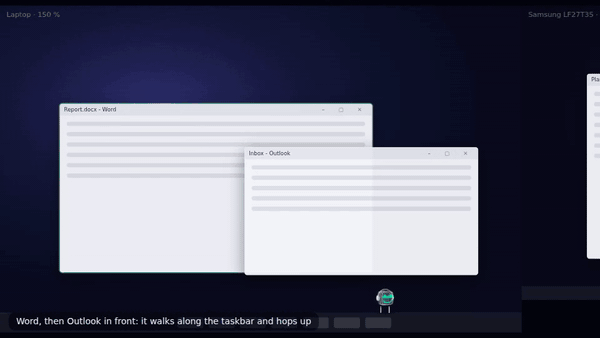
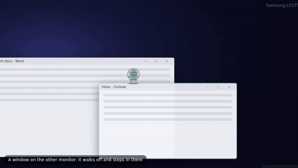
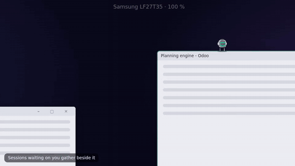
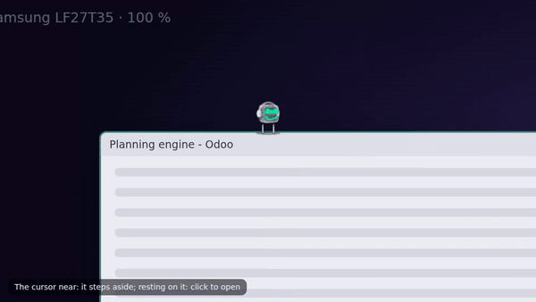
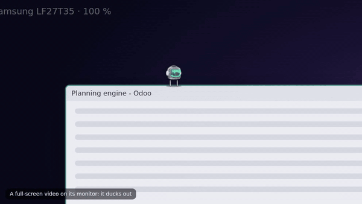
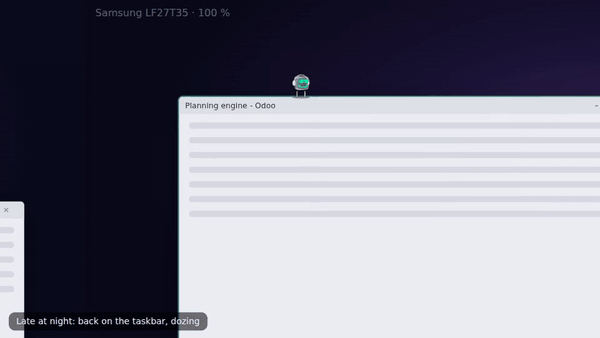
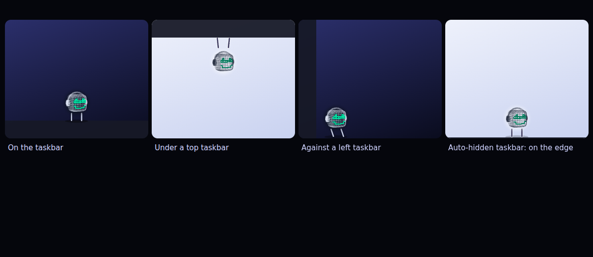

> **Retired in 0.1.13 (2026-10-21).** The user: "Companion mode is overdone. I just want the core showing at the centre top of the screen, on top of all apps, always." Companion mode is now just the core at the top centre of the active monitor (see `mockups/companion-simple/` and desktop/README.md). This design is kept as history.

# Desk companion mode — design note

Approved by the user 2026-10-20 ("the bot steps out of its box and lives on the desktop, like EMO on a real
desk"). Built on desktop 0.1.11; **not released** (no version bump). An opt-in fourth mode of the MINT AI
desktop app, next to Floating, Peek and Desktop layer.

## What it does

| | |
|---|---|
| **Sits** | on the taskbar's top edge (right part by default), or on the top edge of the window in front (a quarter in from its left, away from the caption buttons). Hangs under a top taskbar; stands in the bottom corner against a left or right one. Auto-hide: on the screen's edge, its reveal strip free, riding up onto the taskbar while it shows. A monitor with no taskbar: the floor of its work area. |
| **Moves** | when you switch windows or monitors: a walk along its shelf, then a hop (an arc) to the new one. A new target must hold still 600 ms (Alt+Tab, dragging a window) and the bot stays 2.5 s where it arrived unless its perch went away. To the other monitor: it walks to this monitor's edge, steps out, the window crosses (at the new monitor's DPI, from the main thread), it steps in at the facing edge and walks on. |
| **Idle** | stretches or looks around every 25–50 s when nothing happens; its eyes follow the cursor within ~900 px; dozes with core E's own rule (ten quiet minutes, or a quiet minute after 23:00) and walks back to the taskbar to sleep; hops (core E's grin) when a session finishes or a long turn is done; nods when an approval goes through. |
| **Session bots** | the sessions waiting on you (status waiting, or an approval they asked for) walk in and stand beside it wearing their own heads; at most 3, the longest waiting first, each keeps its slot; they wander off when they are back at work. A click on one opens that session in the Command Center. Off in Settings. |
| **Never in the way** | click-through everywhere except the bot's circle and the session bots. The cursor lingering near it (or passing slowly over it) makes it step aside one step (128 logical px, away from the cursor; at the shelf's end, past the cursor). Resting the cursor *on* it (250 ms, slow) means you want it: it looks up, "Click to open"; no click within 1.6 s and it steps aside after all. Ducks out (hides) for something full screen **on its own monitor** (`policy::fullscreen_hold`, unchanged: Windows' "busy" alone never counts), a meeting, the lock screen; a full-screen window on the other monitor is not followed. |
| **Click** | opens the usual Command Center as Peek on the bot's monitor; Esc / empty space / Ctrl+Alt+M closes it and the bot is back. |

 
  

## How it is built

**One small window that moves with the bot** — 264 × 140 logical px (396 × 210 physical at 150 %), never a
full-screen overlay. The page draws the bot in it; the app moves it.

- `desktop/src-tauri/src/companion.rs` — **pure**: monitors, taskbars, the window in front and the cursor in;
  `taskbar_perch` / `window_perch` / `choose` (the setting), `pick_monitor` (stay / follow the active monitor,
  never follow a full-screen window), `keep_place` (stays where it stepped to; rides a moved window), `Follow`
  (settle, dwell), `plan` / `sample` (Walk, Hop, Out, Cross, In, Jump legs; the window's top-left per frame),
  `Dodge` (step aside / attention), `meeting` / `duck`, `walk_fps`, `idle_period_ms`, `look_at`. 23 tests in
  core-tests (taskbar edges, auto-hide hidden / shown / sliding, the laptop + Samsung DPI, crossing, step-aside,
  full-screen ducking on its own monitor only, meetings, settings).
- `companion_host.rs` — the app's loop, its own thread: reads geometry every 250 ms, the camera / microphone
  every 3 s, the cursor at 33 ms near the bot (120 ms otherwise, 500 ms holding still, 1 s ducked); walks at
  60 fps (30 on battery; holding still: no walk, it jumps). The walk moves the window with an **asynchronous
  SetWindowPos** from that thread (nobody waits); a crossing and every resize go through `apply()` on the main
  thread. It never holds the app's lock across a window call (the 0.1.0 rule). Events to the page:
  `mint://companion` (walk, hop, out, in, jump, arrive + view, duck, pop, attention, attention-off) and
  `mint://companion-look`.
- `platform.rs` — Windows only, **geometry only**: `monitors()` (EnumDisplayMonitors, GetMonitorInfo,
  GetDpiForMonitor), `taskbars()` (SHAppBarMessage ABM_GETTASKBARPOS / ABM_GETSTATE, Shell_TrayWnd and
  Shell_SecondaryTrayWnd rectangles), `front_window` (DWM extended frame bounds, MonitorFromWindow; now with
  its HWND), `move_window`, `cap_use` (HKCU …\CapabilityAccessManager\ConsentStore\webcam|microphone: which
  apps have the device open — names and times). No screen capture, no input injection, nothing read from any
  window's contents.
- `lib.rs` — `Mode::Companion`; `apply()` places its small window (or the work area while its Peek is open);
  the tray switch (on / back to the mode it came from: `settings.before_companion`); command `companion`
  (open / doze / wake; granted to the site in remote.json); **no acrylic blur in this mode** (`blur_glass`) —
  the bot has its own backplate, and a shown blur window must never move (0.1.10).
- `settings.rs` — `companion { perch: taskbar|windows|both, session_bots, stay_on_monitor, side }`.
- `dist/settings.html` — Mode ▸ Companion; a Companion section (where it sits, session bots, stay on this monitor).
- Page: `dashboard/public/mint-desktop-companion.js` (new) — the bot (its own core E instance, desk mode =
  its backplate, the viewer's head and colours), short legs and a contact shadow (or arms when hanging), the
  poses, idle moments, the session bots (core E's kids), the hit regions, the click. `mint-desktop.js` only
  hands it the bridge and lays Companion out (out: the bot only; open: Peek); the Command Center's own core
  rests while the bot is out. `mint-desktop.css`: its few rules. `lib/views-moniai.js`: one asset line.
  moni-ai.js and cc-*.js are untouched.

The preview is the real logic: `desktop/core-tests/examples/companion_sim.rs` runs companion.rs on a scripted
day (the user's two monitors), `dashboard/tools/shots-desk-companion.cjs` draws the desk and plays the frames
with the **real companion page** in the moving window (a scratch server, headless Chromium), and cuts these GIFs.

## Defaults chosen

- Perch **Both** (windows when one can hold it, else the taskbar); session bots **on**; **follow** the active
  monitor; right part of the taskbar (80 %, remembered where it steps to).
- Settle 600 ms, dwell 2.5 s, walk 300 logical px/s, hops 420–900 ms, a step aside 128 px, grace 180 ms,
  "on purpose" after 250 ms resting, attention for 1.6 s.
- A meeting = another app's camera in use, or another app's microphone while MINT AI has no call of its own
  (MINT AI's own entries — `mint-desktop`, `msedgewebview2` — never count).
- Not in the tray as a separate perch menu: the tray has one switch; the perch lives in Settings.

## Open questions

1. **Default perch**: Both is the EMO feel but moves more; Taskbar is calmer. Laptop week will tell.
2. **Meetings**: the registry flags are cheap but attribute some apps oddly (WebView2-based apps that are not
   packaged would be ignored, being named `msedgewebview2`). Teams (new) is packaged and counts.
3. **Downgrade**: a settings file with `"mode":"companion"` read by 0.1.11 falls back to all defaults
   (serde rejects the unknown mode) — harmless but resets the user's other settings once.
4. **Deploy order**: the page must go out before (or with) the app that sends `mode: companion` — an older
   page would lay the small window out as Floating.
5. Not built: dragging the bot by hand to a spot, a per-monitor "home", the bot carrying a toast's text.
